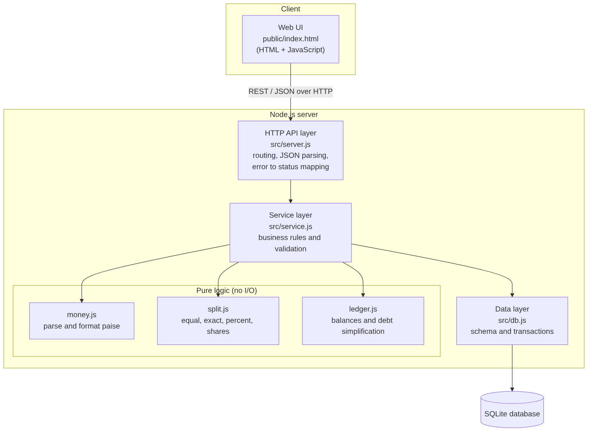
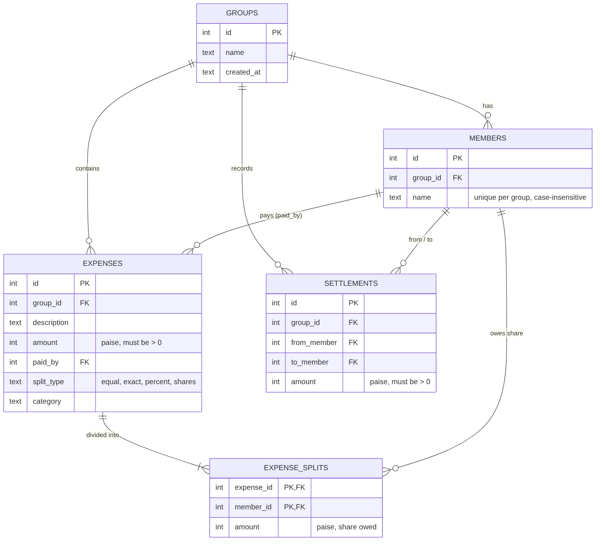
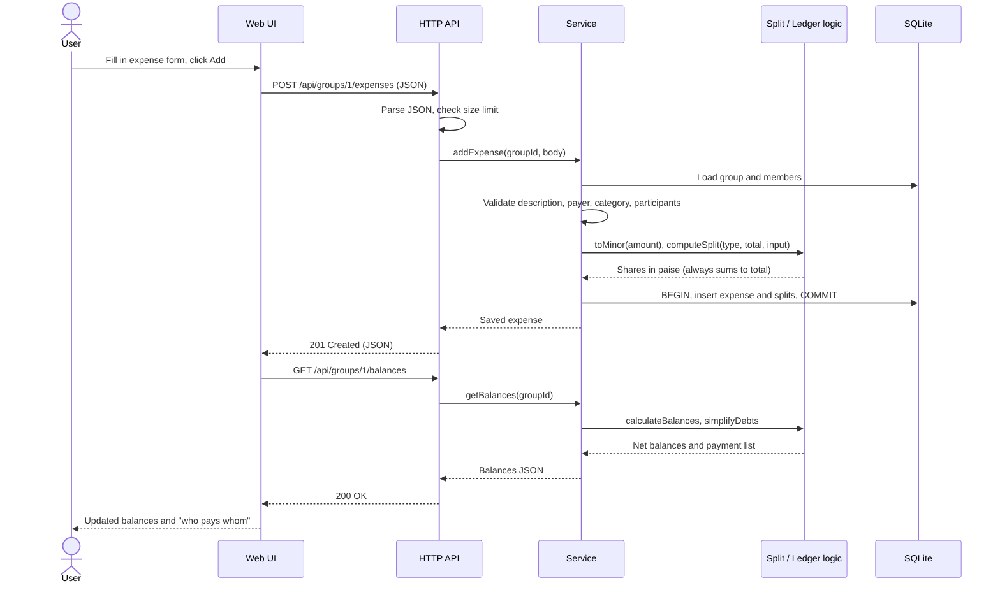
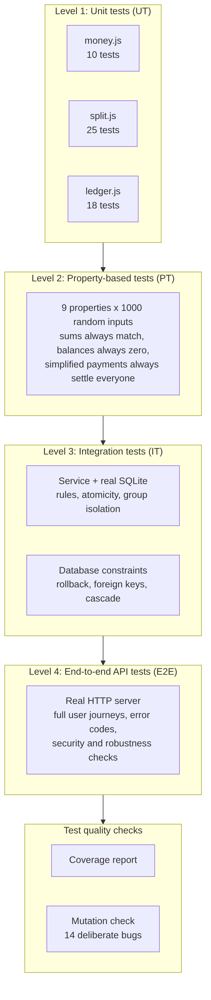

# Expense Splitter

A Splitwise-style web app for sharing group expenses fairly. Add expenses, split them four different ways, and see exactly who owes whom, reduced to the fewest payments. Built for a software design and testing assignment, so the emphasis is on correctness and a thorough automated test suite.

- **116 automated tests**, all passing: unit, property-based (1000 random inputs each), integration, and end-to-end API tests
- **99.6% line coverage, 99.1% branch coverage**
- **Mutation check:** 14 of 14 deliberately injected bugs are detected by the tests
- **No dependencies to install:** uses only what ships with Node.js 22.13+ (built-in test runner, built-in SQLite, built-in HTTP server)

## Features

- Create groups and add members
- Record expenses with four split types:
  - **Equal** (everyone, or a chosen subset)
  - **Exact amounts** (must add up to the total)
  - **Percentages** (must add up to 100)
  - **Shares** (for example 2 nights vs 3 nights)
- Exact money handling: no floating point errors, and rounding leftovers (for example Rs 100 between 3 people) are distributed fairly and deterministically
- Balances per member, and a **simplified settle-up list** (if A owes B and B owes C, A pays C directly)
- Record settlements, delete expenses, expense categories
- REST API plus a one-page web UI

## Run it

Requires Node.js 22.13 or newer. There is nothing to install.

```bash
npm start
# open http://localhost:3000
```

Optional settings: `PORT` (default 3000) and `DB_PATH` (default `expense-splitter.db` in the project folder).

## Run the tests

```bash
npm test               # run everything
npm run test:verbose   # every test listed with a tick or cross
npm run coverage       # tests plus coverage table
node tools/mutation-check.js   # mutation check (about 15 seconds)
node tools/gen-test-plan.js    # regenerate docs/TEST_PLAN.md from the real tests
```

Saved outputs from the last run are in `docs/`: `test-results.txt`, `coverage-report.txt`, `mutation-report.txt`, and the full table of test cases in `docs/TEST_PLAN.md`.

## Architecture



The system is split into layers so each part can be tested on its own:

| Layer | File | Responsibility |
|---|---|---|
| UI | `public/index.html` | One-page interface, talks to the API with `fetch` |
| HTTP API | `src/server.js` | Routing, JSON parsing, body size limit, mapping errors to status codes (400, 404, 405, 413, 500) |
| Service | `src/service.js` | Business rules: membership checks, validation, transactions |
| Pure logic | `src/money.js`, `src/split.js`, `src/ledger.js` | Maths only, no database and no HTTP, so they are easy to test exhaustively |
| Data | `src/db.js` | SQLite schema, constraints, transaction helper |

### Data model



### Adding an expense



Diagram sources are in `docs/diagrams/*.mmd` (Mermaid).

## Key design decisions

1. **Money is stored as whole paise (integers), never as floating point.** `0.1 + 0.2` is not `0.3` in JavaScript; with integers, totals are always exact. Input with more than 2 decimal places is rejected rather than silently rounded.
2. **Largest remainder method for rounding.** When an amount cannot be divided evenly, each person gets the rounded-down share and the leftover paise go to whoever has the largest fractional remainder (ties broken by member id). The parts always add up to exactly the total, and the result is the same every time.
3. **Greedy debt simplification.** Repeatedly match the largest debtor with the largest creditor. It needs at most (people with a balance minus 1) payments. It is not guaranteed to find the absolute minimum in every case (that problem is NP-hard); it is the standard practical approach.
4. **Defence in depth.** Rules are enforced in the service layer and again by database constraints (foreign keys, `CHECK` amounts > 0, unique names per group), so a bug in one layer cannot silently corrupt data.
5. **Atomic writes.** An expense and its splits are saved in a single transaction; a failure leaves nothing behind.

## API

| Method | Path | Purpose |
|---|---|---|
| GET | `/api/health` | Health check |
| GET | `/api/meta` | Split types and categories |
| POST | `/api/groups` | Create a group `{ name, members: [names] }` |
| GET | `/api/groups/:id` | Group with members |
| POST | `/api/groups/:id/members` | Add a member `{ name }` |
| GET | `/api/groups/:id/expenses` | List expenses |
| POST | `/api/groups/:id/expenses` | Add an expense (see below) |
| DELETE | `/api/groups/:id/expenses/:expenseId` | Delete an expense |
| GET | `/api/groups/:id/settlements` | List settlements |
| POST | `/api/groups/:id/settlements` | Record a payment `{ from, to, amount }` |
| GET | `/api/groups/:id/balances` | Net balances and simplified payments |

Add an expense:

```json
{ "description": "Dinner", "amount": 1200, "paidBy": 1, "category": "food",
  "splitType": "equal", "participants": [1, 2, 3] }
```

For `exact`, `percent` and `shares`, send `"splits": { "<memberId>": value }` instead of `participants`.
Errors always look like `{ "error": { "code": "PERCENT_SUM_INVALID", "message": "..." } }`.

## Testing approach



See `docs/TEST_PLAN.md` for all 116 test cases with their results. Highlights:

- **Property-based tests** check rules that must always hold, with 1000 seeded random inputs each: splits always add up to the total, balances always sum to zero, following the suggested payments always settles everyone, and expense order never changes the outcome.
- **Boundary and error-guessing tests** cover amounts of 0, 0.01 and the maximum allowed value, 1 paisa split three ways, floating point artefacts, SQL-injection text, unicode, duplicate names that differ only by case, and cross-group access.
- **Integration and end-to-end tests** run against a real SQLite database and a real HTTP server, not mocks.
- **Mutation check** (`tools/mutation-check.js`) injects 14 deliberate bugs into the source one at a time and confirms the test suite fails for each.

### Defects found during development

1. **Huge numbers reported the wrong error.** An amount such as `1e21` was reported as "not a valid number" instead of "too large", because JavaScript switches to exponent notation at that size. Found by test `UT-M07`, fixed in `src/money.js`.
2. **A gap in the tests themselves.** The first mutation run showed that a bug in the rounding tie-break survived, because every rounding test used equal weights where the tie-break hides the bug. Tests `UT-S24` and `UT-S25` were added with unequal weights; the mutant is now caught.

## Known limitations

- No login or user accounts; anyone with the group link can edit it. This is a prototype of the core logic.
- One currency (INR). An expense has one payer.
- Expenses cannot be edited, only deleted and re-added.
- A settlement larger than the current debt is accepted and simply reverses the direction of the debt.
- The web UI is verified by a manual walk-through (screenshots in `docs/screenshots/`) rather than automated browser tests.

## Project structure

```
src/        server, service layer, pure logic, database layer
public/     web UI
tests/      all automated tests
tools/      mutation check and test-plan generator
docs/       diagrams, screenshots, test plan, saved test / coverage / mutation output
```
